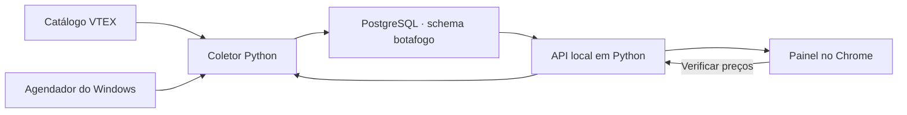

# Radar Botafogo Store

Monitor local de preços da [loja oficial do Botafogo](https://store.botafogo.com.br/). A coleta consulta o catálogo VTEX, registra preços e estoque no PostgreSQL e mantém o histórico por produto, SKU e vendedor. O painel abre no Chrome em [http://127.0.0.1:8765/](http://127.0.0.1:8765/) no computador em que o monitor está em execução.

Este repositório reúne a documentação. Os scripts e o painel descritos aqui estão na instalação local do Monitor-Botafogo.

## Intuito do projeto

O Radar existe para detectar **quedas reais no preço de venda**, especialmente quando um produto que já estava em promoção fica ainda mais barato. Ele mostra quanto o preço caiu em relação à última leitura válida da mesma variação, além do desconto anunciado pela loja.

Para retomar o projeto com outra IA, comece pelo [contexto do projeto](docs/contexto-do-projeto.md). O [AGENTS.md](AGENTS.md) indica quais regras preservar e quais guias consultar.

| Guia | Conteúdo |
| --- | --- |
| [Contexto do projeto](docs/contexto-do-projeto.md) | Intuito, requisitos da vitrine, decisões e estado da implementação |
| [Operação no Windows](docs/operacao-local.md) | Requisitos, inicialização, configuração, coleta de duas em duas horas, diagnóstico e testes |
| [Banco, coleta e API](docs/banco-e-coleta.md) | Tabelas, consulta final, regras de preços, histórico e rotas locais |
| [Painel e GitHub Pages](docs/painel-e-pages.md) | Edição do HTML, vitrine agrupada e proposta de publicação estática |

## Fluxo dos dados

Para montar a lista de preços com data de consulta e histórico, bastam **duas tabelas**. `observations` guarda as ofertas e `runs` guarda as rodadas. A instalação usa ainda `targets` para metas, favoritos e mensagens por variação, e `settings` para o modelo geral do WhatsApp.
